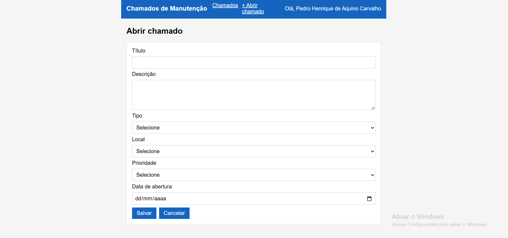
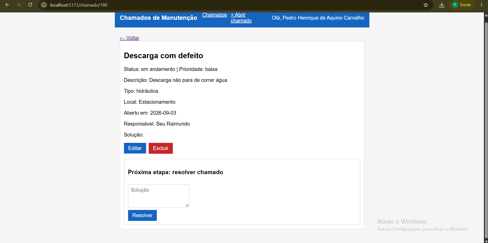
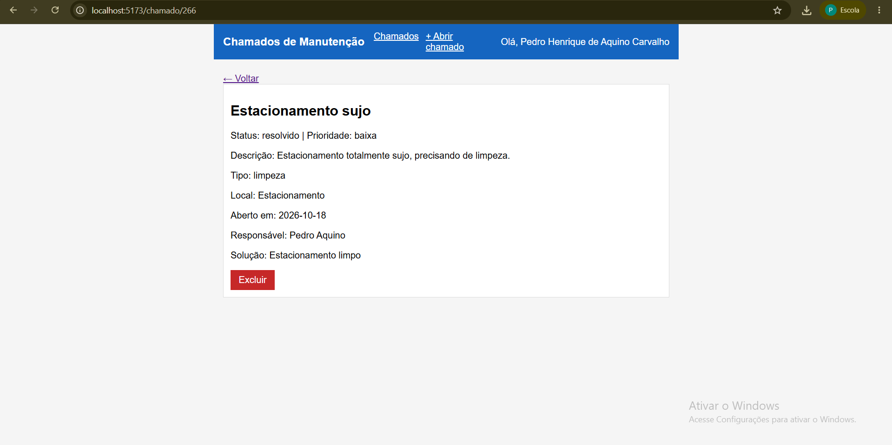

# Sistema de Chamados de Manutenção — Front-end

Front-end em React + Vite que consome a API de chamados de manutenção do IFRN Campus Pau dos Ferros.

Projeto da disciplina de Programação para Internet.

## O que o sistema faz

- Mostra o nome do dono da chave no topo
- Lista chamados com busca por texto e filtros (status, tipo, local e prioridade)
- Detalhe do chamado em `/chamado/:id`
- Abre e edita chamados (resolvidos não podem ser editados)
- Inicia o atendimento (informando o responsável) e resolve o chamado (informando a solução)
- Exclui chamado com confirmação

## Como rodar

1. Instale as dependências:
   ```
   npm install
   ```
2. Crie o arquivo `.env` na raiz do projeto com a sua chave (veja `.env.example`):
   ```
   VITE_API_KEY=sua-chave-aqui
   ```
3. Rode o projeto:
   ```
   npm run dev
   ```
4. Abra o endereço mostrado no terminal (geralmente `http://localhost:5173`).

> Se mudar o `.env`, pare o `npm run dev` e rode de novo.

## Estrutura

```
src/
  components/   Cabecalho
  pages/        PaginaInicial, PaginaDetalhe, PaginaFormulario
  services/     api.js (instância do Axios)
  erro.js       transforma o erro da API em mensagem
```

## Screenshot





